# Diccionario de datos · TactiVision IA

> Generado con `scripts/data_dictionary.py` a partir de la base de datos (esquema + migraciones).
> No se edita a mano: si cambia el esquema, se vuelve a generar.

29 tablas y 8 vistas.

## Diagrama entidad-relación

```mermaid
erDiagram
    ai_recommendations {
        varchar id PK
        varchar match_id FK
        varchar severity
        varchar status
    }
    analysis_strengths {
        varchar id PK
        varchar analysis_id FK
        varchar status
    }
    audit_log {
        bigint id PK
    }
    detections {
        varchar id PK
        varchar video_analysis_id FK
        varchar player_id FK
    }
    formations {
        varchar id PK
        varchar name
    }
    match_events {
        varchar id PK
        varchar match_id FK
    }
    match_formations {
        varchar id PK
        varchar match_id FK
        varchar formation_id FK
    }
    match_tactical_plays {
        varchar id PK
        varchar match_id FK
        varchar tactical_play_id FK
    }
    matches {
        varchar id PK
        varchar team_id FK
        timestamp match_date
        varchar status
    }
    notification_reads {
        varchar notification_id FK
        varchar user_id FK
    }
    notifications {
        varchar id PK
        varchar team_id FK
        varchar analysis_id FK
        varchar match_id FK
    }
    player_team_history {
        varchar id PK
        varchar player_id FK
        varchar team_id FK
    }
    players {
        varchar id PK
        varchar team_id FK
        varchar status
    }
    recommendation_indicators {
        varchar id PK
        varchar recommendation_id FK
        varchar indicator_id FK
    }
    recommendation_notes {
        varchar id PK
        varchar recommendation_id FK
        varchar author_id FK
    }
    reports {
        varchar id PK
        varchar team_id FK
        varchar generated_by FK
    }
    tactical_indicators {
        varchar id PK
        varchar video_analysis_id FK
        varchar name
        numeric value
    }
    tactical_play_versions {
        varchar id PK
        varchar tactical_play_id FK
        varchar created_by FK
    }
    tactical_plays {
        varchar id PK
        varchar team_id FK
        varchar name
    }
    team_action_types {
        varchar id PK
        varchar team_id FK
        varchar name
        varchar created_by FK
    }
    team_crests {
        varchar team_id PK
    }
    teams {
        varchar id PK
        varchar coach_id FK
        varchar name
    }
    track_labels {
        varchar analysis_id FK
        varchar role
        varchar labelled_by FK
    }
    track_links {
        varchar analysis_id FK
        varchar status
        varchar decided_by FK
    }
    track_role_suggestions {
        varchar analysis_id FK
        varchar dismissed_by FK
    }
    track_snapshots {
        varchar analysis_id FK
    }
    users {
        varchar id PK
        varchar email
        varchar role
        varchar team_id FK
    }
    video_analyses {
        varchar id PK
        varchar video_id FK
        varchar status
    }
    videos {
        varchar id PK
        varchar match_id FK
        varchar status
    }
    matches ||--o{ ai_recommendations : "match_id"
    video_analyses ||--o{ analysis_strengths : "analysis_id"
    players |o--o{ detections : "player_id"
    video_analyses ||--o{ detections : "video_analysis_id"
    matches ||--o{ match_events : "match_id"
    formations ||--o{ match_formations : "formation_id"
    matches ||--o{ match_formations : "match_id"
    matches ||--o{ match_tactical_plays : "match_id"
    tactical_plays ||--o{ match_tactical_plays : "tactical_play_id"
    teams ||--o{ matches : "team_id"
    notifications ||--o{ notification_reads : "notification_id"
    users ||--o{ notification_reads : "user_id"
    video_analyses |o--o{ notifications : "analysis_id"
    matches |o--o{ notifications : "match_id"
    teams ||--o{ notifications : "team_id"
    players ||--o{ player_team_history : "player_id"
    teams ||--o{ player_team_history : "team_id"
    teams |o--o{ players : "team_id"
    tactical_indicators ||--o{ recommendation_indicators : "indicator_id"
    ai_recommendations ||--o{ recommendation_indicators : "recommendation_id"
    users |o--o{ recommendation_notes : "author_id"
    ai_recommendations ||--o{ recommendation_notes : "recommendation_id"
    users |o--o{ reports : "generated_by"
    teams ||--o{ reports : "team_id"
    video_analyses ||--o{ tactical_indicators : "video_analysis_id"
    users |o--o{ tactical_play_versions : "created_by"
    tactical_plays ||--o{ tactical_play_versions : "tactical_play_id"
    teams ||--o{ tactical_plays : "team_id"
    users |o--o{ team_action_types : "created_by"
    teams ||--o{ team_action_types : "team_id"
    teams ||--o{ team_crests : "team_id"
    users ||--o{ teams : "coach_id"
    video_analyses ||--o{ track_labels : "analysis_id"
    users |o--o{ track_labels : "labelled_by"
    video_analyses ||--o{ track_links : "analysis_id"
    users |o--o{ track_links : "decided_by"
    video_analyses ||--o{ track_role_suggestions : "analysis_id"
    users |o--o{ track_role_suggestions : "dismissed_by"
    video_analyses ||--o{ track_snapshots : "analysis_id"
    teams |o--o{ users : "team_id"
    videos ||--o{ video_analyses : "video_id"
    matches ||--o{ videos : "match_id"
```

## Tablas

### `ai_recommendations`

Posibles problemas tácticos y recomendaciones de la IA.

| Columna | Tipo | Nulo | Por defecto | Descripción |
|---|---|---|---|---|
| `id` | varchar(36) | no |  | Identificador. |
| `match_id` | varchar(36) | no |  | Partido. |
| `title` | varchar(255) | no |  | Posible problema. |
| `description` | varchar(255) | no |  | Recomendación. |
| `severity` | varchar(50) | no |  | HIGH, MEDIUM o LOW. |
| `confidence` | numeric(10,4) | no |  | Confianza (0 a 1). |
| `evidence` | varchar(255) | no |  | Datos que lo justifican. |
| `created_at` | timestamp | no | CURRENT_TIMESTAMP | Fecha. |
| `status` | varchar(50) | no | 'GENERATED' | GENERATED, REVIEWED, CONFIRMED o DISMISSED (revisión humana). |
| `team` | varchar(20) | sí |  | Equipo al que se refiere: TEAM_A, TEAM_B o MATCH (métrica del partido); vacío en análisis antiguos. |
| `explanation` | text | sí |  | JSON: explicación en lenguaje de fútbol (qué vio la IA, qué significa, qué trabajar) y un cuadro real que lo muestra. |

**Reglas**

- Regla: `CHECK (((confidence >= (0)::numeric) AND (confidence <= (1)::numeric)))`
- Regla: `CHECK (((explanation IS NULL) OR ((explanation)::jsonb ? 'seen'::text)))`
- Regla: `CHECK (((status)::text = ANY ((ARRAY['GENERATED'::character varying, 'REVIEWED'::character varying, 'CONFIRMED'::character varying, 'DISMISSED'::character varying])::text[])))`
- Regla: `CHECK (((team IS NULL) OR ((team)::text = ANY ((ARRAY['TEAM_A'::character varying, 'TEAM_B'::character varying, 'MATCH'::character varying])::text[]))))`
- Regla: `CHECK (((severity)::text = ANY ((ARRAY['HIGH'::character varying, 'MEDIUM'::character varying, 'LOW'::character varying])::text[])))`
- Clave foránea → `matches`: `FOREIGN KEY (match_id) REFERENCES matches(id) ON DELETE CASCADE`
- Clave primaria: `PRIMARY KEY (id)`

**Índices**

- `idx_recommendations_match`: `btree (match_id)`
- `idx_recommendations_match_status`: `btree (match_id, status)`

**Disparadores**

- `trg_audit_ai_recommendations`: `AFTER INSERT OR DELETE OR UPDATE` → `audit_row_change()`

**Seguridad por filas (RLS)**

- `recommendations_via_match` (ALL): `(app_rls_bypass() OR (EXISTS ( SELECT 1    FROM matches m   WHERE ((m.id)::text = (ai_recommendations.match_id)::text))))`

### `analysis_strengths`

Lo que el equipo hizo bien en cada análisis (fortalezas), con su evidencia y explicación.

| Columna | Tipo | Nulo | Por defecto | Descripción |
|---|---|---|---|---|
| `id` | varchar(36) | no |  | Identificador de la fortaleza. |
| `analysis_id` | varchar(36) | no |  | Análisis al que pertenece; se borra con él. |
| `team` | varchar(10) | no |  | TEAM_A, TEAM_B o MATCH (métrica del partido). |
| `code` | varchar(50) | no |  | Regla que la encontró (LINES_TOGETHER, NOBODY_ISOLATED, PRESSURE_ON_BALL, ATTACKING_DEPTH). |
| `title` | varchar(255) | no |  | Título en español, por ejemplo «Líneas juntas al defender». |
| `evidence` | text | no |  | Los números que la sostienen (porcentaje de cuadros del lado bueno y promedio). |
| `confidence` | numeric(10,4) | no |  | Confianza de 0 a 1 (constancia, muestra, detección, separación de equipos y fiabilidad de la regla). |
| `indicator` | varchar(100) | sí |  | Indicador del que sale, por ejemplo team_a.defensive_midfield_distance. |
| `explanation` | text | sí |  | JSON: qué se vio, qué significa, cómo mantenerlo y un cuadro de ejemplo para dibujar en la cancha. |
| `created_at` | timestamp | no | CURRENT_TIMESTAMP | Cuándo se guardó. |
| `status` | varchar(20) | no | 'GENERATED' | GENERATED (sin revisar), CONFIRMED o DISMISSED: el plan de partido solo usa las confirmadas. |

**Reglas**

- Regla: `CHECK (((confidence >= (0)::numeric) AND (confidence <= (1)::numeric)))`
- Regla: `CHECK (((explanation IS NULL) OR ((explanation)::jsonb ? 'seen'::text)))`
- Regla: `CHECK (((status)::text = ANY ((ARRAY['GENERATED'::character varying, 'CONFIRMED'::character varying, 'DISMISSED'::character varying])::text[])))`
- Regla: `CHECK (((team)::text = ANY ((ARRAY['TEAM_A'::character varying, 'TEAM_B'::character varying, 'MATCH'::character varying])::text[])))`
- Clave foránea → `video_analyses`: `FOREIGN KEY (analysis_id) REFERENCES video_analyses(id) ON DELETE CASCADE`
- Clave primaria: `PRIMARY KEY (id)`

**Índices**

- `idx_analysis_strengths_analysis`: `btree (analysis_id)`

**Seguridad por filas (RLS)**

- `strengths_via_analysis` (ALL): `(app_rls_bypass() OR (EXISTS ( SELECT 1    FROM video_analyses va   WHERE ((va.id)::text = (analysis_strengths.analysis_id)::text))))`

### `audit_log`

Auditoría: quién cambió qué y cuándo (escrita por triggers).

| Columna | Tipo | Nulo | Por defecto | Descripción |
|---|---|---|---|---|
| `id` | bigint | no | nextval('audit_log_id_seq'::regclass) | Identificador. |
| `table_name` | varchar(63) | no |  | Tabla modificada. |
| `row_id` | varchar(80) | sí |  | Fila modificada: su id, o sus columnas clave unidas por "/" (análisis/trayectoria). |
| `action` | varchar(6) | no |  | INSERT, UPDATE o DELETE. |
| `changed_by` | varchar(36) | sí |  | Usuario de la aplicación (app.current_user_id). |
| `changed_at` | timestamp | no | CURRENT_TIMESTAMP | Fecha. |
| `changed_fields` | jsonb | no |  | Fila nueva, fila borrada o columnas cambiadas (sin contraseñas). |

**Reglas**

- Regla: `CHECK (((action)::text = ANY ((ARRAY['INSERT'::character varying, 'UPDATE'::character varying, 'DELETE'::character varying])::text[])))`
- Clave primaria: `PRIMARY KEY (id)`

**Índices**

- `idx_audit_log_changed_at`: `btree (changed_at DESC)`
- `idx_audit_log_row`: `btree (table_name, row_id, changed_at DESC)`

**Seguridad por filas (RLS)**

- Activa sin políticas: nadie ve filas salvo el dueño.

### `detections`

Jugadores y balón detectados en cada cuadro.

| Columna | Tipo | Nulo | Por defecto | Descripción |
|---|---|---|---|---|
| `id` | varchar(36) | no |  | Identificador. |
| `video_analysis_id` | varchar(36) | no |  | Análisis. |
| `player_id` | varchar(36) | sí |  | Jugador asignado a la pista (opcional). |
| `frame_number` | integer | no |  | Cuadro del video. |
| `timestamp` | numeric(10,4) | no |  | Segundo del video. |
| `object_type` | varchar(50) | no |  | PLAYER o BALL. |
| `confidence` | numeric(10,4) | no |  | Confianza del detector (0 a 1). |
| `bounding_box_x` | numeric(10,4) | no |  | Caja: x. |
| `bounding_box_y` | numeric(10,4) | no |  | Caja: y. |
| `bounding_box_width` | numeric(10,4) | no |  | Caja: ancho. |
| `bounding_box_height` | numeric(10,4) | no |  | Caja: alto. |
| `player_number` | integer | sí |  | Dorsal (0 a 99) que una persona escribió para la trayectoria; lo comparten todas sus detecciones. |
| `track_id` | integer | sí |  | Número de la trayectoria (0 o más) que dio el tracker; NULL si no siguió a esa persona. |

**Reglas**

- Regla: `CHECK (((player_number IS NULL) OR ((player_number >= 0) AND (player_number <= 99)))) NOT VALID` *(NOT VALID: solo filas nuevas)*
- Regla: `CHECK (((track_id IS NULL) OR (track_id >= 0))) NOT VALID` *(NOT VALID: solo filas nuevas)*
- Regla: `CHECK (((confidence >= (0)::numeric) AND (confidence <= (1)::numeric)))`
- Clave foránea → `players`: `FOREIGN KEY (player_id) REFERENCES players(id) ON DELETE SET NULL`
- Clave foránea → `video_analyses`: `FOREIGN KEY (video_analysis_id) REFERENCES video_analyses(id) ON DELETE CASCADE`
- Clave primaria: `PRIMARY KEY (id)`

**Índices**

- `idx_detections_analysis_frame`: `btree (video_analysis_id, frame_number)`
- `idx_detections_analysis_track`: `btree (video_analysis_id, track_id)`
- `idx_detections_player`: `btree (player_id) WHERE (player_id IS NOT NULL)`

**Seguridad por filas (RLS)**

- `detections_via_analysis` (ALL): `(app_rls_bypass() OR (EXISTS ( SELECT 1    FROM video_analyses va   WHERE ((va.id)::text = (detections.video_analysis_id)::text))))`

### `formations`

Catálogo compartido de formaciones (4-3-3, 4-4-2...).

| Columna | Tipo | Nulo | Por defecto | Descripción |
|---|---|---|---|---|
| `id` | varchar(36) | no |  | Identificador. |
| `name` | varchar(255) | no |  | Nombre único. |
| `description` | varchar(255) | sí |  | Descripción. |
| `player_count` | integer | no | 11 | Jugadores (1 a 11). |
| `created_at` | timestamp | no | CURRENT_TIMESTAMP | Fecha de creación. |

**Reglas**

- Regla: `CHECK (formation_name_is_valid((name)::text)) NOT VALID` *(NOT VALID: solo filas nuevas)*
- Regla: `CHECK (((player_count >= 1) AND (player_count <= 11)))`
- Clave primaria: `PRIMARY KEY (id)`
- Único: `UNIQUE (name)`

### `match_events`

Eventos registrados durante un partido.

| Columna | Tipo | Nulo | Por defecto | Descripción |
|---|---|---|---|---|
| `id` | varchar(36) | no |  | Identificador. |
| `match_id` | varchar(36) | no |  | Partido. |
| `minute` | integer | no |  | Minuto. |
| `second` | integer | no | 0 | Segundo (0 a 59). |
| `event_type` | varchar(255) | no |  | Tipo: GOAL, SHOT, FOUL, CORNER, cartas, cambios... |
| `zone` | varchar(255) | sí |  | Zona de la cancha. |
| `source_x` | numeric(10,4) | sí |  | Posición horizontal opcional. |
| `source_y` | numeric(10,4) | sí |  | Posición vertical opcional. |
| `result` | varchar(255) | sí |  | Resultado del evento. |

**Reglas**

- Regla: `CHECK ((minute >= 0))`
- Regla: `CHECK (((second >= 0) AND (second <= 59)))`
- Clave foránea → `matches`: `FOREIGN KEY (match_id) REFERENCES matches(id) ON DELETE CASCADE`
- Clave primaria: `PRIMARY KEY (id)`

**Índices**

- `idx_match_events_match`: `btree (match_id)`

**Seguridad por filas (RLS)**

- `match_events_via_match` (ALL): `(app_rls_bypass() OR (EXISTS ( SELECT 1    FROM matches m   WHERE ((m.id)::text = (match_events.match_id)::text))))`

### `match_formations`

Formaciones usadas en un partido.

| Columna | Tipo | Nulo | Por defecto | Descripción |
|---|---|---|---|---|
| `id` | varchar(36) | no |  | Identificador. |
| `match_id` | varchar(36) | no |  | Partido. |
| `formation_id` | varchar(36) | no |  | Formación. |

**Reglas**

- Clave foránea → `formations`: `FOREIGN KEY (formation_id) REFERENCES formations(id) ON DELETE CASCADE`
- Clave foránea → `matches`: `FOREIGN KEY (match_id) REFERENCES matches(id) ON DELETE CASCADE`
- Clave primaria: `PRIMARY KEY (id)`
- Único: `UNIQUE (match_id, formation_id)`

**Seguridad por filas (RLS)**

- `match_formations_via_match` (ALL): `(app_rls_bypass() OR (EXISTS ( SELECT 1    FROM matches m   WHERE ((m.id)::text = (match_formations.match_id)::text))))`

### `match_tactical_plays`

Jugadas aplicadas a un partido.

| Columna | Tipo | Nulo | Por defecto | Descripción |
|---|---|---|---|---|
| `id` | varchar(36) | no |  | Identificador. |
| `match_id` | varchar(36) | no |  | Partido. |
| `tactical_play_id` | varchar(36) | no |  | Jugada. |

**Reglas**

- Clave foránea → `matches`: `FOREIGN KEY (match_id) REFERENCES matches(id) ON DELETE CASCADE`
- Clave foránea → `tactical_plays`: `FOREIGN KEY (tactical_play_id) REFERENCES tactical_plays(id) ON DELETE CASCADE`
- Clave primaria: `PRIMARY KEY (id)`
- Único: `UNIQUE (match_id, tactical_play_id)`

**Seguridad por filas (RLS)**

- `match_tactical_plays_via_match` (ALL): `(app_rls_bypass() OR (EXISTS ( SELECT 1    FROM matches m   WHERE ((m.id)::text = (match_tactical_plays.match_id)::text))))`

### `matches`

Partidos de cada equipo.

| Columna | Tipo | Nulo | Por defecto | Descripción |
|---|---|---|---|---|
| `id` | varchar(36) | no |  | Identificador. |
| `team_id` | varchar(36) | no |  | Equipo. |
| `opponent` | varchar(255) | no |  | Rival. |
| `is_home` | boolean | no | true | Verdadero si fue de local. |
| `match_date` | timestamp | no |  | Fecha y hora. |
| `home_score` | integer | sí |  | Goles del equipo. |
| `away_score` | integer | sí |  | Goles del rival. |
| `result` | varchar(255) | sí |  | WIN, LOSS o DRAW (necesita ambos marcadores). |
| `location` | varchar(255) | sí |  | Estadio o lugar. |
| `status` | varchar(255) | no | 'SCHEDULED' | SCHEDULED, PLAYED o CANCELLED. |

**Reglas**

- Regla: `CHECK ((away_score >= 0))`
- Regla: `CHECK ((home_score >= 0))`
- Regla: `CHECK (((result IS NULL) OR ((home_score IS NOT NULL) AND (away_score IS NOT NULL))))`
- Regla: `CHECK (((result IS NULL) OR ((result)::text = ANY ((ARRAY['WIN'::character varying, 'LOSS'::character varying, 'DRAW'::character varying])::text[]))))`
- Regla: `CHECK (((status)::text = ANY ((ARRAY['SCHEDULED'::character varying, 'PLAYED'::character varying, 'CANCELLED'::character varying])::text[])))`
- Clave foránea → `teams`: `FOREIGN KEY (team_id) REFERENCES teams(id) ON DELETE CASCADE`
- Clave primaria: `PRIMARY KEY (id)`

**Índices**

- `idx_matches_team_date`: `btree (team_id, match_date)`
- `idx_matches_team_status_date`: `btree (team_id, status, match_date)`

**Disparadores**

- `trg_audit_matches`: `AFTER INSERT OR DELETE OR UPDATE` → `audit_row_change()`

**Seguridad por filas (RLS)**

- `matches_team_isolation` (ALL): `app_can_see_team(team_id)`

### `notification_reads`

Qué notificaciones leyó (o eliminó de su campana) cada usuario.

| Columna | Tipo | Nulo | Por defecto | Descripción |
|---|---|---|---|---|
| `notification_id` | varchar(36) | no |  | Notificación. |
| `user_id` | varchar(36) | no |  | Usuario. |
| `read_at` | timestamp | no | CURRENT_TIMESTAMP | Fecha de lectura. |
| `hidden_at` | timestamp | sí |  | Cuándo el usuario eliminó la notificación de su campana; vacío si la sigue viendo. Los demás del equipo la siguen viendo. |

**Reglas**

- Regla: `CHECK (((hidden_at IS NULL) OR (hidden_at >= read_at)))`
- Clave foránea → `notifications`: `FOREIGN KEY (notification_id) REFERENCES notifications(id) ON DELETE CASCADE`
- Clave foránea → `users`: `FOREIGN KEY (user_id) REFERENCES users(id) ON DELETE CASCADE`
- Clave primaria: `PRIMARY KEY (notification_id, user_id)`

**Índices**

- `idx_notification_reads_user`: `btree (user_id)`

**Seguridad por filas (RLS)**

- `notification_reads_owner` (ALL): `(app_rls_bypass() OR (((user_id)::text = (app_current_user())::text) AND (EXISTS ( SELECT 1    FROM notifications n   WHERE ((n.id)::text = (notification_reads.notification_id)::text)))))`

### `notifications`

Notificaciones de cada equipo (la campana).

| Columna | Tipo | Nulo | Por defecto | Descripción |
|---|---|---|---|---|
| `id` | varchar(36) | no |  | Identificador. |
| `team_id` | varchar(36) | no |  | Equipo. |
| `event` | varchar(40) | no |  | ANALYSIS_COMPLETED, TACTICAL_ALERT... |
| `analysis_id` | varchar(36) | sí |  | Análisis relacionado. |
| `match_id` | varchar(36) | sí |  | Partido relacionado. |
| `message` | varchar(500) | no |  | Texto. |
| `created_at` | timestamp | no | CURRENT_TIMESTAMP | Fecha. |

**Reglas**

- Regla: `CHECK (((event)::text = ANY ((ARRAY['ANALYSIS_COMPLETED'::character varying, 'ANALYSIS_FAILED'::character varying, 'ANALYSIS_CANCELLED'::character varying, 'TACTICAL_ALERT'::character varying, 'ANALYST_JOINED'::character varying, 'PLAYER_RETURN_DUE'::character varying, 'RECOMMENDATION_NOTE'::character varying])::text[])))`
- Clave foránea → `video_analyses`: `FOREIGN KEY (analysis_id) REFERENCES video_analyses(id) ON DELETE SET NULL`
- Clave foránea → `matches`: `FOREIGN KEY (match_id) REFERENCES matches(id) ON DELETE SET NULL`
- Clave foránea → `teams`: `FOREIGN KEY (team_id) REFERENCES teams(id) ON DELETE CASCADE`
- Clave primaria: `PRIMARY KEY (id)`

**Índices**

- `idx_notifications_team_created`: `btree (team_id, created_at DESC)`

**Seguridad por filas (RLS)**

- `notifications_team_isolation` (ALL): `app_can_see_team(team_id)`

### `player_team_history`

Historial de equipos de cada jugador.

| Columna | Tipo | Nulo | Por defecto | Descripción |
|---|---|---|---|---|
| `id` | varchar(36) | no |  | Identificador. |
| `player_id` | varchar(36) | no |  | Jugador. |
| `team_id` | varchar(36) | no |  | Equipo. |
| `joined_at` | timestamp | no | CURRENT_TIMESTAMP | Fecha de llegada. |
| `left_at` | timestamp | sí |  | Fecha de salida (NULL si sigue). |
| `withdrawal_reason` | varchar(255) | sí |  | Motivo de la salida. |

**Reglas**

- Regla: `CHECK (((left_at IS NULL) OR (left_at >= joined_at)))`
- Clave foránea → `players`: `FOREIGN KEY (player_id) REFERENCES players(id) ON DELETE CASCADE`
- Clave foránea → `teams`: `FOREIGN KEY (team_id) REFERENCES teams(id) ON DELETE CASCADE`
- Clave primaria: `PRIMARY KEY (id)`

**Índices**

- `idx_player_history_player`: `btree (player_id, joined_at)`

**Seguridad por filas (RLS)**

- `player_history_team_isolation` (ALL): `app_can_see_team(team_id)`

### `players`

Plantilla de cada equipo.

| Columna | Tipo | Nulo | Por defecto | Descripción |
|---|---|---|---|---|
| `id` | varchar(36) | no |  | Identificador. |
| `team_id` | varchar(36) | sí |  | Equipo actual (NULL si quedó sin equipo). |
| `first_name` | varchar(255) | no |  | Nombre. |
| `last_name` | varchar(255) | no |  | Apellido. |
| `shirt_number` | integer | sí |  | Dorsal (0 a 99). |
| `position` | varchar(255) | sí |  | GOALKEEPER, DEFENDER, MIDFIELDER o FORWARD. |
| `status` | varchar(255) | no | 'ACTIVE' | ACTIVE, INJURED, SUSPENDED, UNAVAILABLE (motivo personal u otro) o INACTIVE (de baja). |
| `created_at` | timestamp | no | CURRENT_TIMESTAMP | Fecha de alta. |
| `preferred_foot` | varchar(10) | sí |  | RIGHT, LEFT o BOTH. |
| `availability_note` | varchar(255) | sí |  | Motivo de la ausencia, escrito por el entrenador (lesión, sanción, motivo personal). |
| `expected_return` | date | sí |  | Fecha estimada de regreso; ese día la campana lo recuerda. |
| `return_notified_on` | date | sí |  | Fecha de regreso que ya se recordó (para avisar una sola vez). |

**Reglas**

- Regla: `CHECK ((((status)::text = ANY ((ARRAY['INJURED'::character varying, 'SUSPENDED'::character varying, 'UNAVAILABLE'::character varying])::text[])) OR ((availability_note IS NULL) AND (expected_return IS NULL))))`
- Regla: `CHECK (((preferred_foot IS NULL) OR ((preferred_foot)::text = ANY ((ARRAY['RIGHT'::character varying, 'LEFT'::character varying, 'BOTH'::character varying])::text[]))))`
- Regla: `CHECK (((shirt_number >= 0) AND (shirt_number <= 99)))`
- Regla: `CHECK (((status)::text = ANY ((ARRAY['ACTIVE'::character varying, 'INJURED'::character varying, 'SUSPENDED'::character varying, 'UNAVAILABLE'::character varying, 'INACTIVE'::character varying])::text[])))`
- Clave foránea → `teams`: `FOREIGN KEY (team_id) REFERENCES teams(id) ON DELETE SET NULL`
- Clave primaria: `PRIMARY KEY (id)`

**Índices**

- `idx_players_expected_return`: `btree (team_id, expected_return) WHERE (expected_return IS NOT NULL)`
- `idx_players_team`: `btree (team_id)`
- `idx_players_team_shirt`: `btree (team_id, shirt_number)`

**Disparadores**

- `trg_audit_players`: `AFTER INSERT OR DELETE OR UPDATE` → `audit_row_change()`

**Seguridad por filas (RLS)**

- `players_team_isolation` (ALL): `app_can_see_team(team_id)`

### `recommendation_indicators`

Indicadores que sustentan cada recomendación.

| Columna | Tipo | Nulo | Por defecto | Descripción |
|---|---|---|---|---|
| `id` | varchar(36) | no |  | Identificador. |
| `recommendation_id` | varchar(36) | no |  | Recomendación. |
| `indicator_id` | varchar(36) | no |  | Indicador. |

**Reglas**

- Clave foránea → `tactical_indicators`: `FOREIGN KEY (indicator_id) REFERENCES tactical_indicators(id) ON DELETE CASCADE`
- Clave foránea → `ai_recommendations`: `FOREIGN KEY (recommendation_id) REFERENCES ai_recommendations(id) ON DELETE CASCADE`
- Clave primaria: `PRIMARY KEY (id)`
- Único: `UNIQUE (recommendation_id, indicator_id)`

**Índices**

- `idx_recommendation_indicators_indicator`: `btree (indicator_id)`

**Seguridad por filas (RLS)**

- `recommendation_links_via_recommendation` (ALL): `(app_rls_bypass() OR (EXISTS ( SELECT 1    FROM ai_recommendations r   WHERE ((r.id)::text = (recommendation_indicators.recommendation_id)::text))))`

### `recommendation_notes`

Notas del cuerpo técnico sobre un posible problema: lo que una persona interpreta, firmado.

| Columna | Tipo | Nulo | Por defecto | Descripción |
|---|---|---|---|---|
| `id` | varchar(36) | no |  | Identificador de la nota. |
| `recommendation_id` | varchar(36) | no |  | Posible problema al que se refiere; se borra con él. |
| `author_id` | varchar(36) | sí |  | Quién la escribió (analista o entrenador); queda vacío si el usuario se elimina. |
| `text` | varchar(1000) | no |  | La nota (de 1 a 1000 caracteres). |
| `created_at` | timestamp | no | CURRENT_TIMESTAMP | Cuándo se escribió. |
| `updated_at` | timestamp | no | CURRENT_TIMESTAMP | Cuándo se editó por última vez. |

**Reglas**

- Regla: `CHECK (((length(btrim((text)::text)) >= 1) AND (length(btrim((text)::text)) <= 1000)))`
- Clave foránea → `users`: `FOREIGN KEY (author_id) REFERENCES users(id) ON DELETE SET NULL`
- Clave foránea → `ai_recommendations`: `FOREIGN KEY (recommendation_id) REFERENCES ai_recommendations(id) ON DELETE CASCADE`
- Clave primaria: `PRIMARY KEY (id)`

**Índices**

- `idx_recommendation_notes_recommendation`: `btree (recommendation_id, created_at)`

**Seguridad por filas (RLS)**

- `notes_via_recommendation` (ALL): `(app_rls_bypass() OR (EXISTS ( SELECT 1    FROM ai_recommendations r   WHERE ((r.id)::text = (recommendation_notes.recommendation_id)::text))))`

### `reports`

Reportes generados (partido, análisis o evolución).

| Columna | Tipo | Nulo | Por defecto | Descripción |
|---|---|---|---|---|
| `id` | varchar(36) | no |  | Identificador. |
| `team_id` | varchar(36) | no |  | Equipo. |
| `generated_by` | varchar(36) | sí |  | Usuario que lo generó. |
| `title` | varchar(255) | no |  | Título. |
| `report_type` | varchar(50) | no |  | MATCH, VIDEO_ANALYSIS o TEAM_EVOLUTION. |
| `generated_at` | timestamp | no | CURRENT_TIMESTAMP | Fecha. |
| `version` | integer | no | 1 | Versión (desde 1). |
| `snapshot_data` | text | no |  | JSON con los datos del reporte en ese momento. |

**Reglas**

- Regla: `CHECK (((report_type)::text = ANY ((ARRAY['MATCH'::character varying, 'VIDEO_ANALYSIS'::character varying, 'TEAM_EVOLUTION'::character varying])::text[])))`
- Regla: `CHECK ((version >= 1))`
- Clave foránea → `users`: `FOREIGN KEY (generated_by) REFERENCES users(id) ON DELETE SET NULL`
- Clave foránea → `teams`: `FOREIGN KEY (team_id) REFERENCES teams(id) ON DELETE CASCADE`
- Clave primaria: `PRIMARY KEY (id)`

**Índices**

- `idx_reports_team`: `btree (team_id)`
- `idx_reports_team_generated`: `btree (team_id, generated_at DESC)`

**Disparadores**

- `trg_audit_reports`: `AFTER INSERT OR DELETE OR UPDATE` → `audit_row_change()`

**Seguridad por filas (RLS)**

- `reports_team_isolation` (ALL): `app_can_see_team(team_id)`

### `tactical_indicators`

Indicadores tácticos de cada análisis.

| Columna | Tipo | Nulo | Por defecto | Descripción |
|---|---|---|---|---|
| `id` | varchar(36) | no |  | Identificador. |
| `video_analysis_id` | varchar(36) | no |  | Análisis. |
| `name` | varchar(255) | no |  | Nombre, por ejemplo team_a.team_width. |
| `value` | numeric(10,4) | no |  | Valor promedio. |
| `unit` | varchar(50) | no |  | Unidad (proporción de imagen, jugadores, pases...). |
| `calculated_at` | timestamp | no | CURRENT_TIMESTAMP | Fecha del cálculo. |
| `threshold` | numeric(10,4) | sí |  | Umbral de referencia (NULL si no tiene). |
| `samples` | integer | sí |  | Cuadros en que se midió (solo los de su fase de juego, si tiene). NULL en análisis anteriores a 0019. |
| `exceed_ratio` | numeric(5,4) | sí |  | Proporción de esos cuadros del lado malo del umbral (0..1). NULL en análisis anteriores a 0019. |

**Reglas**

- Regla: `CHECK (((exceed_ratio IS NULL) OR ((exceed_ratio >= (0)::numeric) AND (exceed_ratio <= (1)::numeric))))`
- Regla: `CHECK (((samples IS NULL) OR (samples >= 0)))`
- Clave foránea → `video_analyses`: `FOREIGN KEY (video_analysis_id) REFERENCES video_analyses(id) ON DELETE CASCADE`
- Clave primaria: `PRIMARY KEY (id)`

**Índices**

- `idx_indicators_analysis`: `btree (video_analysis_id)`
- `idx_indicators_analysis_name`: `btree (video_analysis_id, name)`

**Seguridad por filas (RLS)**

- `indicators_via_analysis` (ALL): `(app_rls_bypass() OR (EXISTS ( SELECT 1    FROM video_analyses va   WHERE ((va.id)::text = (tactical_indicators.video_analysis_id)::text))))`

### `tactical_play_versions`

Versiones de cada jugada (patrón Prototype + pila de versiones).

| Columna | Tipo | Nulo | Por defecto | Descripción |
|---|---|---|---|---|
| `id` | varchar(36) | no |  | Identificador. |
| `tactical_play_id` | varchar(36) | no |  | Jugada. |
| `created_by` | varchar(36) | sí |  | Usuario que la guardó. |
| `version_number` | integer | no |  | Número de versión (desde 1). |
| `configuration_data` | text | no |  | JSON con jugadores y flechas. |
| `created_at` | timestamp | no | CURRENT_TIMESTAMP | Fecha de la versión. |
| `is_current` | boolean | no | false | Verdadero en la versión vigente. |

**Reglas**

- Regla: `CHECK ((version_number >= 1))`
- Clave foránea → `users`: `FOREIGN KEY (created_by) REFERENCES users(id) ON DELETE SET NULL`
- Clave foránea → `tactical_plays`: `FOREIGN KEY (tactical_play_id) REFERENCES tactical_plays(id) ON DELETE CASCADE`
- Clave primaria: `PRIMARY KEY (id)`
- Único: `UNIQUE (tactical_play_id, version_number)`

**Seguridad por filas (RLS)**

- `play_versions_via_play` (ALL): `(app_rls_bypass() OR (EXISTS ( SELECT 1    FROM tactical_plays tp   WHERE ((tp.id)::text = (tactical_play_versions.tactical_play_id)::text))))`

### `tactical_plays`

Jugadas diseñadas en el editor táctico.

| Columna | Tipo | Nulo | Por defecto | Descripción |
|---|---|---|---|---|
| `id` | varchar(36) | no |  | Identificador. |
| `team_id` | varchar(36) | no |  | Equipo. |
| `name` | varchar(255) | no |  | Nombre. |
| `description` | varchar(255) | sí |  | Descripción. |
| `action_type` | varchar(255) | sí |  | BUILD_UP, PRESSING, COUNTER_ATTACK... |
| `created_at` | timestamp | no | CURRENT_TIMESTAMP | Fecha de creación. |
| `is_reusable` | boolean | no | true | Si se puede aplicar a otros partidos. |

**Reglas**

- Regla: `CHECK (((action_type IS NULL) OR (char_length((action_type)::text) <= 40))) NOT VALID` *(NOT VALID: solo filas nuevas)*
- Regla: `CHECK (((description IS NULL) OR (char_length((description)::text) <= 100))) NOT VALID` *(NOT VALID: solo filas nuevas)*
- Regla: `CHECK ((char_length((name)::text) <= 50)) NOT VALID` *(NOT VALID: solo filas nuevas)*
- Clave foránea → `teams`: `FOREIGN KEY (team_id) REFERENCES teams(id) ON DELETE CASCADE`
- Clave primaria: `PRIMARY KEY (id)`

**Disparadores**

- `trg_audit_tactical_plays`: `AFTER INSERT OR DELETE OR UPDATE` → `audit_row_change()`

**Seguridad por filas (RLS)**

- `tactical_plays_team_isolation` (ALL): `app_can_see_team(team_id)`

### `team_action_types`

Tipos de acción escritos por el equipo para sus jugadas, además de los fijos del editor.

| Columna | Tipo | Nulo | Por defecto | Descripción |
|---|---|---|---|---|
| `id` | varchar(36) | no |  | Identificador (UUID). |
| `team_id` | varchar(36) | no |  | Equipo dueño del tipo. |
| `name` | varchar(40) | no |  | Nombre del tipo de acción (2 a 40 caracteres), único por equipo sin distinguir mayúsculas. |
| `created_by` | varchar(36) | sí |  | Quién lo escribió. |
| `created_at` | timestamp | no | CURRENT_TIMESTAMP | Cuándo se creó. |

**Reglas**

- Regla: `CHECK ((((char_length(btrim((name)::text)) >= 2) AND (char_length(btrim((name)::text)) <= 40)) AND ((name)::text = btrim((name)::text))))`
- Clave foránea → `users`: `FOREIGN KEY (created_by) REFERENCES users(id) ON DELETE SET NULL`
- Clave foránea → `teams`: `FOREIGN KEY (team_id) REFERENCES teams(id) ON DELETE CASCADE`
- Clave primaria: `PRIMARY KEY (id)`

**Seguridad por filas (RLS)**

- `team_action_types_team_isolation` (ALL): `app_can_see_team(team_id)`

### `team_crests`

Escudo del equipo: una imagen PNG de 256 px por equipo, re-codificada por el backend.

| Columna | Tipo | Nulo | Por defecto | Descripción |
|---|---|---|---|---|
| `team_id` | varchar(36) | no |  | Equipo dueño del escudo. |
| `content_type` | varchar(20) | no |  | Tipo de la imagen guardada (siempre image/png). |
| `image` | bytea | no |  | Bytes de la imagen PNG (máximo 300 KB). |
| `updated_at` | timestamp | no | CURRENT_TIMESTAMP | Cuándo se cambió el escudo por última vez. |

**Reglas**

- Regla: `CHECK (((content_type)::text = 'image/png'::text))`
- Regla: `CHECK (((octet_length(image) >= 1) AND (octet_length(image) <= 300000)))`
- Clave foránea → `teams`: `FOREIGN KEY (team_id) REFERENCES teams(id) ON DELETE CASCADE`
- Clave primaria: `PRIMARY KEY (team_id)`

**Seguridad por filas (RLS)**

- `team_crests_team_isolation` (ALL): `app_can_see_team(team_id)`

### `teams`

Equipos; cada entrenador tiene uno.

| Columna | Tipo | Nulo | Por defecto | Descripción |
|---|---|---|---|---|
| `id` | varchar(36) | no |  | Identificador. |
| `coach_id` | varchar(36) | no |  | Entrenador dueño del equipo (único). |
| `name` | varchar(255) | no |  | Nombre del equipo. |
| `category` | varchar(255) | sí |  | Categoría (por ejemplo Sub-20). |
| `city` | varchar(255) | sí |  | Ciudad. |
| `description` | varchar(255) | sí |  | Descripción. |
| `invitation_code` | varchar(20) | no |  | Código para que un analista se una. |
| `created_at` | timestamp | no | CURRENT_TIMESTAMP | Fecha de creación. |
| `is_active` | boolean | no | true | Falso si el equipo fue desactivado. |
| `kit_color` | varchar(7) | sí |  | Color habitual de la camiseta del equipo (#rrggbb); se propone al analizar un video. |

**Reglas**

- Regla: `CHECK (((kit_color IS NULL) OR ((kit_color)::text ~ '^#[0-9a-f]{6}$'::text)))`
- Clave foránea → `users`: `FOREIGN KEY (coach_id) REFERENCES users(id)`
- Clave primaria: `PRIMARY KEY (id)`
- Único: `UNIQUE (coach_id)`
- Único: `UNIQUE (invitation_code)`

**Disparadores**

- `trg_audit_teams`: `AFTER INSERT OR DELETE OR UPDATE` → `audit_row_change()`

**Seguridad por filas (RLS)**

- `teams_admin_read` (SELECT): `((app_current_role())::text = 'ADMINISTRATOR'::text)`
- `teams_member_access` (ALL): `(app_can_see_team(id) OR ((coach_id)::text = (app_current_user())::text))`

### `track_labels`

Trayectorias que una persona marcó como árbitro o persona externa (no son jugadores).

| Columna | Tipo | Nulo | Por defecto | Descripción |
|---|---|---|---|---|
| `analysis_id` | varchar(36) | no |  | Análisis al que pertenece; se borra con él. |
| `track_id` | integer | no |  | Número de la trayectoria dentro del video (el mismo de detections.track_id). |
| `role` | varchar(10) | no |  | REFEREE (árbitro o juez de línea) u OTHER (persona externa al juego). |
| `labelled_by` | varchar(36) | sí |  | Quién la marcó. |
| `labelled_at` | timestamp | no | CURRENT_TIMESTAMP | Cuándo la marcó. |

**Reglas**

- Regla: `CHECK ((track_id >= 0)) NOT VALID` *(NOT VALID: solo filas nuevas)*
- Regla: `CHECK (((role)::text = ANY ((ARRAY['REFEREE'::character varying, 'OTHER'::character varying])::text[])))`
- Clave foránea → `video_analyses`: `FOREIGN KEY (analysis_id) REFERENCES video_analyses(id) ON DELETE CASCADE`
- Clave foránea → `users`: `FOREIGN KEY (labelled_by) REFERENCES users(id) ON DELETE SET NULL`
- Clave primaria: `PRIMARY KEY (analysis_id, track_id)`

**Disparadores**

- `trg_audit_track_labels`: `AFTER INSERT OR DELETE OR UPDATE` → `audit_row_change('analysis_id', 'track_id')`

**Seguridad por filas (RLS)**

- `track_labels_via_analysis` (ALL): `(app_rls_bypass() OR (EXISTS ( SELECT 1    FROM video_analyses va   WHERE ((va.id)::text = (track_labels.analysis_id)::text))))`

### `track_links`

Pares de trayectorias que parecen el mismo jugador cortado en dos (sugeridos por la IA) y la decisión de una persona.

| Columna | Tipo | Nulo | Por defecto | Descripción |
|---|---|---|---|---|
| `analysis_id` | varchar(36) | no |  | Análisis al que pertenece; se borra con él. |
| `from_track` | integer | no |  | Trayectoria que termina (detections.track_id). |
| `to_track` | integer | no |  | Trayectoria que empieza después y sería el mismo jugador. |
| `from_last_frame` | integer | no |  | Último cuadro en que se ve from_track. |
| `to_first_frame` | integer | no |  | Primer cuadro en que se ve to_track (siempre después). |
| `gap_seconds` | numeric(6,3) | no |  | Segundos en que el jugador no se vio (máximo 1.5 en la IA). |
| `distance_heights` | numeric(6,3) | no |  | Distancia entre donde debía estar y donde reaparece, en alturas de la caja. |
| `color_distance` | numeric(7,2) | sí |  | Diferencia del color de camiseta (Lab); NULL si no se midió. |
| `same_team` | boolean | sí |  | TRUE si las dos tienen el mismo equipo; NULL si alguna no tiene equipo. |
| `confidence` | numeric(4,3) | no |  | Confianza de la sugerencia (0 a 1). |
| `status` | varchar(9) | no | 'SUGGESTED' | SUGGESTED (sin revisar), ACCEPTED (es el mismo jugador) o REJECTED. |
| `decided_by` | varchar(36) | sí |  | Quién la aceptó o rechazó. |
| `decided_at` | timestamp | sí |  | Cuándo se decidió; NULL mientras es una sugerencia. |
| `created_at` | timestamp | no | CURRENT_TIMESTAMP | Cuándo se guardó la sugerencia. |

**Reglas**

- Regla: `CHECK (((decided_by IS NULL) OR (decided_at IS NOT NULL)))`
- Regla: `CHECK ((((status)::text = 'SUGGESTED'::text) = (decided_at IS NULL)))`
- Regla: `CHECK ((to_first_frame > from_last_frame))`
- Regla: `CHECK ((from_track <> to_track))`
- Regla: `CHECK ((color_distance >= (0)::numeric))`
- Regla: `CHECK (((confidence >= (0)::numeric) AND (confidence <= (1)::numeric)))`
- Regla: `CHECK ((distance_heights >= (0)::numeric))`
- Regla: `CHECK ((from_last_frame >= 0))`
- Regla: `CHECK ((from_track >= 0))`
- Regla: `CHECK ((gap_seconds > (0)::numeric))`
- Regla: `CHECK (((status)::text = ANY ((ARRAY['SUGGESTED'::character varying, 'ACCEPTED'::character varying, 'REJECTED'::character varying])::text[])))`
- Regla: `CHECK ((to_track >= 0))`
- Clave foránea → `video_analyses`: `FOREIGN KEY (analysis_id) REFERENCES video_analyses(id) ON DELETE CASCADE`
- Clave foránea → `users`: `FOREIGN KEY (decided_by) REFERENCES users(id) ON DELETE SET NULL`
- Clave primaria: `PRIMARY KEY (analysis_id, from_track)`
- Único: `UNIQUE (analysis_id, to_track)`

**Disparadores**

- `trg_audit_track_links`: `AFTER INSERT OR DELETE OR UPDATE` → `audit_row_change('analysis_id', 'from_track')`

**Seguridad por filas (RLS)**

- `track_links_via_analysis` (ALL): `(app_rls_bypass() OR (EXISTS ( SELECT 1    FROM video_analyses va   WHERE ((va.id)::text = (track_links.analysis_id)::text))))`

### `track_role_suggestions`

Trayectorias con una camiseta de ningún equipo, agrupadas por color: posible árbitro o arquero (sugerencia de la IA).

| Columna | Tipo | Nulo | Por defecto | Descripción |
|---|---|---|---|---|
| `analysis_id` | varchar(36) | no |  | Análisis al que pertenece; se borra con él. |
| `track_id` | integer | no |  | Trayectoria (detections.track_id). |
| `suggestion` | varchar(21) | no |  | REFEREE (varias personas a la vez con esa camiseta) o GOALKEEPER_OR_REFEREE (una sola a la vez). |
| `kit_group` | smallint | no |  | Grupo de camiseta dentro del análisis: las trayectorias del mismo grupo llevan la misma. |
| `kit_color` | character | no |  | Color medido de esa camiseta (#rrggbb). |
| `kit_tracks` | smallint | no |  | Cuántas trayectorias llevan esa camiseta. |
| `confidence` | numeric(4,3) | no |  | Confianza de la sugerencia (0 a 1). |
| `reason` | varchar(300) | no |  | Por qué se sugiere, en palabras. |
| `dismissed_by` | varchar(36) | sí |  | Quién la descartó. |
| `dismissed_at` | timestamp | sí |  | Cuándo se descartó; NULL si sigue vigente. |
| `created_at` | timestamp | no | CURRENT_TIMESTAMP | Cuándo se guardó la sugerencia. |

**Reglas**

- Regla: `CHECK (((dismissed_by IS NULL) OR (dismissed_at IS NOT NULL)))`
- Regla: `CHECK (((confidence >= (0)::numeric) AND (confidence <= (1)::numeric)))`
- Regla: `CHECK ((kit_color ~ '^#[0-9a-f]{6}$'::text))`
- Regla: `CHECK ((kit_group >= 1))`
- Regla: `CHECK ((kit_tracks >= 1))`
- Regla: `CHECK ((length(TRIM(BOTH FROM reason)) > 0))`
- Regla: `CHECK (((suggestion)::text = ANY ((ARRAY['REFEREE'::character varying, 'GOALKEEPER_OR_REFEREE'::character varying])::text[])))`
- Regla: `CHECK ((track_id >= 0))`
- Clave foránea → `video_analyses`: `FOREIGN KEY (analysis_id) REFERENCES video_analyses(id) ON DELETE CASCADE`
- Clave foránea → `users`: `FOREIGN KEY (dismissed_by) REFERENCES users(id) ON DELETE SET NULL`
- Clave primaria: `PRIMARY KEY (analysis_id, track_id)`

**Índices**

- `idx_track_role_suggestions_kit`: `btree (analysis_id, kit_group)`

**Disparadores**

- `trg_audit_track_role_suggestions`: `AFTER UPDATE OF dismissed_at` → `audit_row_change('analysis_id', 'track_id')`

**Seguridad por filas (RLS)**

- `track_role_suggestions_via_analysis` (ALL): `(app_rls_bypass() OR (EXISTS ( SELECT 1    FROM video_analyses va   WHERE ((va.id)::text = (track_role_suggestions.analysis_id)::text))))`

### `track_snapshots`

Foto de cada trayectoria detectada (el mejor recorte del video) para que el cuerpo técnico reconozca al jugador y lo vincule a la plantilla.

| Columna | Tipo | Nulo | Por defecto | Descripción |
|---|---|---|---|---|
| `analysis_id` | varchar(36) | no |  | Análisis al que pertenece; se borra con él. |
| `track_id` | integer | no |  | Número de la trayectoria dentro del video (el mismo de detections.track_id). |
| `frame_number` | integer | no |  | Cuadro del video del que sale la foto. |
| `timestamp` | numeric(10,4) | no |  | Segundo del video del que sale la foto. |
| `confidence` | numeric(10,4) | no |  | Confianza de la detección de ese cuadro (0 a 1). |
| `width` | integer | no |  | Ancho de la foto en píxeles. |
| `height` | integer | no |  | Alto de la foto en píxeles (máximo 160). |
| `image` | bytea | no |  | Foto en JPEG (unos pocos KB, máximo 60 000 bytes). |
| `created_at` | timestamp | no | CURRENT_TIMESTAMP | Cuándo se guardó. |

**Reglas**

- Regla: `CHECK ((track_id >= 0)) NOT VALID` *(NOT VALID: solo filas nuevas)*
- Regla: `CHECK (((confidence >= (0)::numeric) AND (confidence <= (1)::numeric)))`
- Regla: `CHECK ((frame_number >= 0))`
- Regla: `CHECK ((height > 0))`
- Regla: `CHECK (((octet_length(image) >= 1) AND (octet_length(image) <= 60000)))`
- Regla: `CHECK (("timestamp" >= (0)::numeric))`
- Regla: `CHECK ((width > 0))`
- Clave foránea → `video_analyses`: `FOREIGN KEY (analysis_id) REFERENCES video_analyses(id) ON DELETE CASCADE`
- Clave primaria: `PRIMARY KEY (analysis_id, track_id)`

**Seguridad por filas (RLS)**

- `track_snapshots_via_analysis` (ALL): `(app_rls_bypass() OR (EXISTS ( SELECT 1    FROM video_analyses va   WHERE ((va.id)::text = (track_snapshots.analysis_id)::text))))`

### `users`

Cuentas de la plataforma: administradores, entrenadores y analistas.

| Columna | Tipo | Nulo | Por defecto | Descripción |
|---|---|---|---|---|
| `id` | varchar(36) | no |  | Identificador (UUID). |
| `first_name` | varchar(255) | no |  | Nombre. |
| `last_name` | varchar(255) | no |  | Apellido. |
| `email` | varchar(255) | no |  | Correo de inicio de sesión, único y en minúsculas. |
| `password_hash` | varchar(255) | no |  | Hash bcrypt (costo 12) de la contraseña; nunca la contraseña. |
| `phone` | varchar(255) | sí |  | Teléfono opcional. |
| `profile_image_url` | varchar(255) | sí |  | Foto de perfil opcional. |
| `role` | varchar(20) | no |  | ADMINISTRATOR, COACH o ANALYST. |
| `team_id` | varchar(36) | sí |  | Equipo al que pertenece un analista. |
| `is_active` | boolean | no | true | Falso si el administrador desactivó la cuenta. |
| `created_at` | timestamp | no | CURRENT_TIMESTAMP | Fecha de registro. |
| `updated_at` | timestamp | no | CURRENT_TIMESTAMP | Última modificación. |

**Reglas**

- Regla: `CHECK (((email)::text = lower((email)::text)))`
- Regla: `CHECK (((email)::text ~ '^[^@\s]+@[^@\s]+\.[^@\s]+$'::text))`
- Regla: `CHECK (((char_length((password_hash)::text) = 60) AND ((password_hash)::text ~ '^\$2[aby]\$'::text)))`
- Regla: `CHECK (((role)::text = ANY ((ARRAY['ADMINISTRATOR'::character varying, 'COACH'::character varying, 'ANALYST'::character varying])::text[])))`
- Regla: `CHECK ((updated_at >= created_at))`
- Clave foránea → `teams`: `FOREIGN KEY (team_id) REFERENCES teams(id) ON DELETE SET NULL`
- Clave primaria: `PRIMARY KEY (id)`
- Único: `UNIQUE (email)`

**Índices**

- `idx_users_team`: `btree (team_id)`

**Disparadores**

- `trg_audit_users`: `AFTER INSERT OR DELETE OR UPDATE` → `audit_row_change()`

### `video_analyses`

Análisis de un video hechos por el servicio de IA.

| Columna | Tipo | Nulo | Por defecto | Descripción |
|---|---|---|---|---|
| `id` | varchar(36) | no |  | Identificador. |
| `video_id` | varchar(36) | no |  | Video analizado. |
| `status` | varchar(50) | no | 'PENDING' | PENDING, PROCESSING, COMPLETED, FAILED o CANCELLED. |
| `analysis_mode` | varchar(30) | no | 'REAL_VIDEO_ANALYSIS' | REAL_VIDEO_ANALYSIS o SIMULATION_MODE. |
| `confidence_threshold` | numeric(10,4) | sí |  | Umbral de confianza de la detección. |
| `model_name` | varchar(100) | sí |  | Modelo de IA usado. |
| `model_version` | varchar(50) | sí |  | Versión del modelo. |
| `started_at` | timestamp | sí |  | Inicio. |
| `completed_at` | timestamp | sí |  | Fin. |
| `warning_message` | text | sí |  | Advertencias del análisis (todas, sin recortar) o el motivo del fallo. |
| `proximity_network` | text | sí |  | JSON de la red de cercanía (grafo + BFS). |
| `team_a_color` | varchar(7) | sí |  | Color de camiseta del Equipo A según la IA (#rrggbb); vacío en análisis antiguos o de simulación sin color. |
| `team_b_color` | varchar(7) | sí |  | Color de camiseta del Equipo B según la IA (#rrggbb); vacío en análisis antiguos o de simulación sin color. |
| `own_kit_color` | varchar(7) | sí |  | Color de camiseta de tu equipo indicado para este análisis (#rrggbb); vacío si no se indicó. |
| `own_team` | varchar(10) | sí |  | Cuál de los equipos detectados es el tuyo (TEAM_A o TEAM_B); vacío si no se pudo saber. |

**Reglas**

- Regla: `CHECK (((completed_at IS NULL) OR (started_at IS NULL) OR (completed_at >= started_at)))`
- Regla: `CHECK (((analysis_mode)::text = ANY ((ARRAY['REAL_VIDEO_ANALYSIS'::character varying, 'SIMULATION_MODE'::character varying])::text[])))`
- Regla: `CHECK ((((own_kit_color IS NULL) OR ((own_kit_color)::text ~ '^#[0-9a-f]{6}$'::text)) AND ((own_team IS NULL) OR ((own_team)::text = ANY ((ARRAY['TEAM_A'::character varying, 'TEAM_B'::character varying])::text[])))))`
- Regla: `CHECK (((status)::text = ANY ((ARRAY['PENDING'::character varying, 'PROCESSING'::character varying, 'COMPLETED'::character varying, 'FAILED'::character varying, 'CANCELLED'::character varying])::text[])))`
- Regla: `CHECK ((((team_a_color IS NULL) OR ((team_a_color)::text ~ '^#[0-9a-f]{6}$'::text)) AND ((team_b_color IS NULL) OR ((team_b_color)::text ~ '^#[0-9a-f]{6}$'::text))))`
- Clave foránea → `videos`: `FOREIGN KEY (video_id) REFERENCES videos(id) ON DELETE CASCADE`
- Clave primaria: `PRIMARY KEY (id)`

**Índices**

- `idx_analyses_active`: `btree (status) WHERE ((status)::text = ANY ((ARRAY['PENDING'::character varying, 'PROCESSING'::character varying])::text[]))`
- `idx_video_analyses_video`: `btree (video_id)`

**Seguridad por filas (RLS)**

- `analyses_via_video` (ALL): `(app_rls_bypass() OR (EXISTS ( SELECT 1    FROM videos v   WHERE ((v.id)::text = (video_analyses.video_id)::text))))`

### `videos`

Videos subidos a un partido.

| Columna | Tipo | Nulo | Por defecto | Descripción |
|---|---|---|---|---|
| `id` | varchar(36) | no |  | Identificador. |
| `match_id` | varchar(36) | no |  | Partido. |
| `file_name` | varchar(255) | no |  | Nombre original del archivo. |
| `file_path` | varchar(255) | no |  | Nombre con el que se guardó en el servidor. |
| `format` | varchar(50) | no |  | MP4, MOV, AVI, MKV o WEBM. |
| `file_size` | bigint | no |  | Tamaño en bytes. |
| `duration_seconds` | integer | sí |  | Duración opcional. |
| `uploaded_at` | timestamp | no | CURRENT_TIMESTAMP | Fecha de subida. |
| `status` | varchar(50) | no | 'UPLOADED' | UPLOADED, ANALYZING o ANALYZED. |
| `situation` | varchar(30) | sí |  | Situación táctica que muestra el clip, elegida por una persona (BUILD_UP, POSITIONAL_ATTACK, COUNTER_ATTACK, DEFENSIVE_TRANSITION, PRESSING, DEFENSIVE_BLOCK, SET_PIECE, u OTHER si la escribe el cuerpo técnico). NULL: sin clasificar. |
| `situation_note` | varchar(200) | sí |  | Nota corta del cuerpo técnico sobre el clip (opcional). |
| `situation_custom` | varchar(30) | sí |  | Situación escrita por el cuerpo técnico cuando ninguna fija sirve (hasta 30 caracteres). Solo existe cuando situation es OTHER. |

**Reglas**

- Regla: `CHECK ((file_size > 0))`
- Regla: `CHECK (((((situation)::text IS DISTINCT FROM 'OTHER'::text) AND (situation_custom IS NULL)) OR ((NOT ((situation)::text IS DISTINCT FROM 'OTHER'::text)) AND (situation_custom IS NOT NULL) AND ((length(btrim((situation_custom)::text)) >= 1) AND (length(btrim((situation_custom)::text)) <= 30)))))`
- Regla: `CHECK (((situation_note IS NULL) OR ((length(btrim((situation_note)::text)) >= 1) AND (length(btrim((situation_note)::text)) <= 200))))`
- Regla: `CHECK (((situation IS NULL) OR ((situation)::text = ANY ((ARRAY['BUILD_UP'::character varying, 'POSITIONAL_ATTACK'::character varying, 'COUNTER_ATTACK'::character varying, 'DEFENSIVE_TRANSITION'::character varying, 'PRESSING'::character varying, 'DEFENSIVE_BLOCK'::character varying, 'SET_PIECE'::character varying, 'OTHER'::character varying])::text[]))))`
- Regla: `CHECK (((status)::text = ANY ((ARRAY['UPLOADED'::character varying, 'ANALYZING'::character varying, 'ANALYZED'::character varying])::text[])))`
- Clave foránea → `matches`: `FOREIGN KEY (match_id) REFERENCES matches(id) ON DELETE CASCADE`
- Clave primaria: `PRIMARY KEY (id)`

**Índices**

- `idx_videos_match`: `btree (match_id)`
- `idx_videos_situation`: `btree (situation) WHERE (situation IS NOT NULL)`

**Disparadores**

- `trg_audit_videos`: `AFTER INSERT OR DELETE OR UPDATE` → `audit_row_change()`

**Seguridad por filas (RLS)**

- `videos_via_match` (ALL): `(app_rls_bypass() OR (EXISTS ( SELECT 1    FROM matches m   WHERE ((m.id)::text = (videos.match_id)::text))))`

## Vistas

| Vista | Qué muestra |
|---|---|
| `v_action_type_usage` | Tipos de acción escritos por cada equipo y cuántas de sus jugadas los usan. |
| `v_analysis_indicators` | Indicadores de cada análisis completado con su partido y equipo. |
| `v_identification_progress` | Avance de la identificación de cada clip analizado: trayectorias, con foto, con jugador, solo con dorsal, árbitros, externos y pendientes. |
| `v_match_summary` | Resumen por partido: marcador, videos, análisis y problemas abiertos. |
| `v_open_issues` | Posibles problemas abiertos, el más urgente primero. |
| `v_player_participation` | Participación de cada jugador en los videos analizados. |
| `v_track_identities` | Trayectorias unidas por enlaces aceptados: cada una con la primera de su cadena (el mismo jugador). |
| `v_track_link_review` | Revisión de cada clip analizado: enlaces por decidir, aceptados y rechazados, y sugerencias de árbitro o arquero abiertas. |

### `v_action_type_usage`

| Columna | Tipo |
|---|---|
| `team_id` | varchar(36) |
| `action_type_id` | varchar(36) |
| `name` | varchar(40) |
| `created_at` | timestamp |
| `plays` | bigint |

### `v_analysis_indicators`

| Columna | Tipo |
|---|---|
| `team_id` | varchar(36) |
| `match_id` | varchar(36) |
| `opponent` | varchar(255) |
| `match_date` | timestamp |
| `analysis_id` | varchar(36) |
| `analysis_mode` | varchar(30) |
| `completed_at` | timestamp |
| `indicator` | varchar(255) |
| `value` | numeric(10,4) |
| `unit` | varchar(50) |
| `threshold` | numeric(10,4) |

### `v_identification_progress`

| Columna | Tipo |
|---|---|
| `team_id` | varchar(36) |
| `match_id` | varchar(36) |
| `opponent` | varchar(255) |
| `video_id` | varchar(36) |
| `file_name` | varchar(255) |
| `analysis_id` | varchar(36) |
| `completed_at` | timestamp |
| `tracks` | bigint |
| `tracks_with_photo` | bigint |
| `with_player` | bigint |
| `number_only` | bigint |
| `referees` | bigint |
| `outsiders` | bigint |
| `pending` | bigint |

### `v_match_summary`

| Columna | Tipo |
|---|---|
| `match_id` | varchar(36) |
| `team_id` | varchar(36) |
| `opponent` | varchar(255) |
| `match_date` | timestamp |
| `is_home` | boolean |
| `status` | varchar(255) |
| `result` | varchar(255) |
| `home_score` | integer |
| `away_score` | integer |
| `videos` | bigint |
| `completed_analyses` | bigint |
| `open_issues` | bigint |
| `confirmed_issues` | bigint |

### `v_open_issues`

| Columna | Tipo |
|---|---|
| `team_id` | varchar(36) |
| `recommendation_id` | varchar(36) |
| `match_id` | varchar(36) |
| `opponent` | varchar(255) |
| `match_date` | timestamp |
| `title` | varchar(255) |
| `severity` | varchar(50) |
| `confidence` | numeric(10,4) |
| `status` | varchar(50) |
| `created_at` | timestamp |

### `v_player_participation`

| Columna | Tipo |
|---|---|
| `player_id` | varchar(36) |
| `team_id` | varchar(36) |
| `first_name` | varchar(255) |
| `last_name` | varchar(255) |
| `shirt_number` | integer |
| `detections` | bigint |
| `matches` | bigint |
| `analyses` | bigint |

### `v_track_identities`

| Columna | Tipo |
|---|---|
| `analysis_id` | varchar(36) |
| `track_id` | integer |
| `person_track` | integer |
| `step` | integer |

### `v_track_link_review`

| Columna | Tipo |
|---|---|
| `team_id` | varchar(36) |
| `match_id` | varchar(36) |
| `opponent` | varchar(255) |
| `video_id` | varchar(36) |
| `file_name` | varchar(255) |
| `analysis_id` | varchar(36) |
| `completed_at` | timestamp |
| `links_pending` | bigint |
| `links_accepted` | bigint |
| `links_rejected` | bigint |
| `role_suggestions` | bigint |
| `role_suggestions_open` | bigint |
| `kits` | bigint |

## Funciones

Funciones propias de la base (las de extensiones no se listan).

| Función | Devuelve | Volatilidad | Qué hace |
|---|---|---|---|
| `app_can_see_team(target_team_id character varying)` | boolean | STABLE | Regla central de RLS: verdadero si la fila es del equipo de la sesión o si la sesión es del sistema. |
| `app_current_role()` | character varying | STABLE | Rol del usuario de la sesión (app.current_role): COACH, ANALYST o ADMINISTRATOR. |
| `app_current_team()` | character varying | STABLE | Equipo del usuario de la sesión (app.current_team_id); las políticas RLS comparan cada fila con él. |
| `app_current_user()` | character varying | STABLE | Usuario de la sesión (app.current_user_id), que el backend fija en cada petición; NULL si no hay. |
| `app_rls_bypass()` | boolean | STABLE | Verdadero cuando la sesión pidió saltarse RLS (app.bypass_rls = on): solo tareas del sistema, como un análisis en segundo plano. |
| `audit_row_change()` | trigger | VOLATILE | Trigger de auditoría: escribe en audit_log la fila nueva, la borrada o solo las columnas que cambiaron (sin contraseñas ni documentos grandes). La fila se nombra por su id o por las columnas que se le pasan al trigger. |
| `formation_name_is_valid(formation_name text)` | boolean | IMMUTABLE | Verdadero si el nombre no es un sistema numérico, o si lo es con 2 a 5 líneas de 1 a 6 jugadores que suman 10. |
| `track_identities_of(p_analysis_id character varying)` | TABLE(track_id integer, person_track integer, step integer) | STABLE | Cadenas de trayectorias unidas por enlaces aceptados de UN análisis (lo mismo que v_track_identities, sin recorrer los demás clips). |
