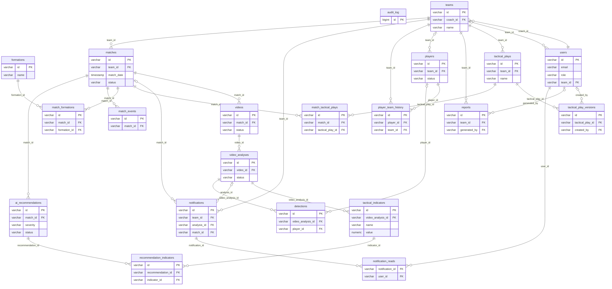

# Diccionario de datos · TactiVision IA

> Generado con `scripts/data_dictionary.py` a partir de la base de datos (esquema + migraciones).
> No se edita a mano: si cambia el esquema, se vuelve a generar.

21 tablas y 4 vistas.

## Diagrama entidad-relación

## Tablas

### `ai_recommendations`

Posibles problemas tácticos y recomendaciones de la IA.

| Columna | Tipo | Nulo | Por defecto | Descripción |
|---|---|---|---|---|
| `id` | varchar(36) | no |  | Identificador. |
| `match_id` | varchar(36) | no |  | Partido. |
| `title` | varchar(255) | no |  | Posible problema. |
| `description` | varchar(255) | no |  | Recomendación. |
| `severity` | varchar(50) | no |  | HIGH, MEDIUM o LOW. |
| `confidence` | numeric(10,4) | no |  | Confianza (0 a 1). |
| `evidence` | varchar(255) | no |  | Datos que lo justifican. |
| `created_at` | timestamp | no | CURRENT_TIMESTAMP | Fecha. |
| `status` | varchar(50) | no | 'GENERATED' | GENERATED, REVIEWED, CONFIRMED o DISMISSED (revisión humana). |
| `team` | varchar(20) | sí |  | Equipo al que se refiere: TEAM_A, TEAM_B o MATCH (métrica del partido); vacío en análisis antiguos. |

**Reglas**

- Regla: `CHECK (((confidence >= (0)::numeric) AND (confidence <= (1)::numeric)))`
- Regla: `CHECK (((status)::text = ANY ((ARRAY['GENERATED'::character varying, 'REVIEWED'::character varying, 'CONFIRMED'::character varying, 'DISMISSED'::character varying])::text[])))`
- Regla: `CHECK (((team IS NULL) OR ((team)::text = ANY ((ARRAY['TEAM_A'::character varying, 'TEAM_B'::character varying, 'MATCH'::character varying])::text[]))))`
- Regla: `CHECK (((severity)::text = ANY ((ARRAY['HIGH'::character varying, 'MEDIUM'::character varying, 'LOW'::character varying])::text[])))`
- Clave foránea → `matches`: `FOREIGN KEY (match_id) REFERENCES matches(id) ON DELETE CASCADE`
- Clave primaria: `PRIMARY KEY (id)`

**Índices**

- `idx_recommendations_match`: `btree (match_id)`
- `idx_recommendations_match_status`: `btree (match_id, status)`

### `audit_log`

Auditoría: quién cambió qué y cuándo (escrita por triggers).

| Columna | Tipo | Nulo | Por defecto | Descripción |
|---|---|---|---|---|
| `id` | bigint | no | nextval('audit_log_id_seq'::regclass) | Identificador. |
| `table_name` | varchar(63) | no |  | Tabla modificada. |
| `row_id` | varchar(36) | sí |  | Fila modificada. |
| `action` | varchar(6) | no |  | INSERT, UPDATE o DELETE. |
| `changed_by` | varchar(36) | sí |  | Usuario de la aplicación (app.current_user_id). |
| `changed_at` | timestamp | no | CURRENT_TIMESTAMP | Fecha. |
| `changed_fields` | jsonb | no |  | Fila nueva, fila borrada o columnas cambiadas (sin contraseñas). |

**Reglas**

- Regla: `CHECK (((action)::text = ANY ((ARRAY['INSERT'::character varying, 'UPDATE'::character varying, 'DELETE'::character varying])::text[])))`
- Clave primaria: `PRIMARY KEY (id)`

**Índices**

- `idx_audit_log_changed_at`: `btree (changed_at DESC)`
- `idx_audit_log_row`: `btree (table_name, row_id, changed_at DESC)`

### `detections`

Jugadores y balón detectados en cada cuadro.

| Columna | Tipo | Nulo | Por defecto | Descripción |
|---|---|---|---|---|
| `id` | varchar(36) | no |  | Identificador. |
| `video_analysis_id` | varchar(36) | no |  | Análisis. |
| `player_id` | varchar(36) | sí |  | Jugador asignado a la pista (opcional). |
| `frame_number` | integer | no |  | Cuadro del video. |
| `timestamp` | numeric(10,4) | no |  | Segundo del video. |
| `object_type` | varchar(50) | no |  | PLAYER o BALL. |
| `confidence` | numeric(10,4) | no |  | Confianza del detector (0 a 1). |
| `bounding_box_x` | numeric(10,4) | no |  | Caja: x. |
| `bounding_box_y` | numeric(10,4) | no |  | Caja: y. |
| `bounding_box_width` | numeric(10,4) | no |  | Caja: ancho. |
| `bounding_box_height` | numeric(10,4) | no |  | Caja: alto. |
| `player_number` | integer | sí |  | Dorsal si se conoce. |
| `track_id` | integer | sí |  | Pista del seguimiento (mismo jugador entre cuadros). |

**Reglas**

- Regla: `CHECK (((confidence >= (0)::numeric) AND (confidence <= (1)::numeric)))`
- Clave foránea → `players`: `FOREIGN KEY (player_id) REFERENCES players(id) ON DELETE SET NULL`
- Clave foránea → `video_analyses`: `FOREIGN KEY (video_analysis_id) REFERENCES video_analyses(id) ON DELETE CASCADE`
- Clave primaria: `PRIMARY KEY (id)`

**Índices**

- `idx_detections_analysis_frame`: `btree (video_analysis_id, frame_number)`
- `idx_detections_analysis_track`: `btree (video_analysis_id, track_id)`
- `idx_detections_player`: `btree (player_id) WHERE (player_id IS NOT NULL)`

### `formations`

Catálogo compartido de formaciones (4-3-3, 4-4-2...).

| Columna | Tipo | Nulo | Por defecto | Descripción |
|---|---|---|---|---|
| `id` | varchar(36) | no |  | Identificador. |
| `name` | varchar(255) | no |  | Nombre único. |
| `description` | varchar(255) | sí |  | Descripción. |
| `player_count` | integer | no | 11 | Jugadores (1 a 11). |
| `created_at` | timestamp | no | CURRENT_TIMESTAMP | Fecha de creación. |

**Reglas**

- Regla: `CHECK (((player_count >= 1) AND (player_count <= 11)))`
- Clave primaria: `PRIMARY KEY (id)`
- Único: `UNIQUE (name)`

### `match_events`

Eventos registrados durante un partido.

| Columna | Tipo | Nulo | Por defecto | Descripción |
|---|---|---|---|---|
| `id` | varchar(36) | no |  | Identificador. |
| `match_id` | varchar(36) | no |  | Partido. |
| `minute` | integer | no |  | Minuto. |
| `second` | integer | no | 0 | Segundo (0 a 59). |
| `event_type` | varchar(255) | no |  | Tipo: GOAL, SHOT, FOUL, CORNER, cartas, cambios... |
| `zone` | varchar(255) | sí |  | Zona de la cancha. |
| `source_x` | numeric(10,4) | sí |  | Posición horizontal opcional. |
| `source_y` | numeric(10,4) | sí |  | Posición vertical opcional. |
| `result` | varchar(255) | sí |  | Resultado del evento. |

**Reglas**

- Regla: `CHECK ((minute >= 0))`
- Regla: `CHECK (((second >= 0) AND (second <= 59)))`
- Clave foránea → `matches`: `FOREIGN KEY (match_id) REFERENCES matches(id) ON DELETE CASCADE`
- Clave primaria: `PRIMARY KEY (id)`

**Índices**

- `idx_match_events_match`: `btree (match_id)`

### `match_formations`

Formaciones usadas en un partido.

| Columna | Tipo | Nulo | Por defecto | Descripción |
|---|---|---|---|---|
| `id` | varchar(36) | no |  | Identificador. |
| `match_id` | varchar(36) | no |  | Partido. |
| `formation_id` | varchar(36) | no |  | Formación. |

**Reglas**

- Clave foránea → `formations`: `FOREIGN KEY (formation_id) REFERENCES formations(id) ON DELETE CASCADE`
- Clave foránea → `matches`: `FOREIGN KEY (match_id) REFERENCES matches(id) ON DELETE CASCADE`
- Clave primaria: `PRIMARY KEY (id)`
- Único: `UNIQUE (match_id, formation_id)`

### `match_tactical_plays`

Jugadas aplicadas a un partido.

| Columna | Tipo | Nulo | Por defecto | Descripción |
|---|---|---|---|---|
| `id` | varchar(36) | no |  | Identificador. |
| `match_id` | varchar(36) | no |  | Partido. |
| `tactical_play_id` | varchar(36) | no |  | Jugada. |

**Reglas**

- Clave foránea → `matches`: `FOREIGN KEY (match_id) REFERENCES matches(id) ON DELETE CASCADE`
- Clave foránea → `tactical_plays`: `FOREIGN KEY (tactical_play_id) REFERENCES tactical_plays(id) ON DELETE CASCADE`
- Clave primaria: `PRIMARY KEY (id)`
- Único: `UNIQUE (match_id, tactical_play_id)`

### `matches`

Partidos de cada equipo.

| Columna | Tipo | Nulo | Por defecto | Descripción |
|---|---|---|---|---|
| `id` | varchar(36) | no |  | Identificador. |
| `team_id` | varchar(36) | no |  | Equipo. |
| `opponent` | varchar(255) | no |  | Rival. |
| `is_home` | boolean | no | true | Verdadero si fue de local. |
| `match_date` | timestamp | no |  | Fecha y hora. |
| `home_score` | integer | sí |  | Goles del equipo. |
| `away_score` | integer | sí |  | Goles del rival. |
| `result` | varchar(255) | sí |  | WIN, LOSS o DRAW (necesita ambos marcadores). |
| `location` | varchar(255) | sí |  | Estadio o lugar. |
| `status` | varchar(255) | no | 'SCHEDULED' | SCHEDULED, PLAYED o CANCELLED. |

**Reglas**

- Regla: `CHECK ((away_score >= 0))`
- Regla: `CHECK ((home_score >= 0))`
- Regla: `CHECK (((result IS NULL) OR ((home_score IS NOT NULL) AND (away_score IS NOT NULL))))`
- Regla: `CHECK (((result IS NULL) OR ((result)::text = ANY ((ARRAY['WIN'::character varying, 'LOSS'::character varying, 'DRAW'::character varying])::text[]))))`
- Regla: `CHECK (((status)::text = ANY ((ARRAY['SCHEDULED'::character varying, 'PLAYED'::character varying, 'CANCELLED'::character varying])::text[])))`
- Clave foránea → `teams`: `FOREIGN KEY (team_id) REFERENCES teams(id) ON DELETE CASCADE`
- Clave primaria: `PRIMARY KEY (id)`

**Índices**

- `idx_matches_team_date`: `btree (team_id, match_date)`
- `idx_matches_team_status_date`: `btree (team_id, status, match_date)`

### `notification_reads`

Qué notificaciones leyó cada usuario.

| Columna | Tipo | Nulo | Por defecto | Descripción |
|---|---|---|---|---|
| `notification_id` | varchar(36) | no |  | Notificación. |
| `user_id` | varchar(36) | no |  | Usuario. |
| `read_at` | timestamp | no | CURRENT_TIMESTAMP | Fecha de lectura. |

**Reglas**

- Clave foránea → `notifications`: `FOREIGN KEY (notification_id) REFERENCES notifications(id) ON DELETE CASCADE`
- Clave foránea → `users`: `FOREIGN KEY (user_id) REFERENCES users(id) ON DELETE CASCADE`
- Clave primaria: `PRIMARY KEY (notification_id, user_id)`

**Índices**

- `idx_notification_reads_user`: `btree (user_id)`

### `notifications`

Notificaciones de cada equipo (la campana).

| Columna | Tipo | Nulo | Por defecto | Descripción |
|---|---|---|---|---|
| `id` | varchar(36) | no |  | Identificador. |
| `team_id` | varchar(36) | no |  | Equipo. |
| `event` | varchar(40) | no |  | ANALYSIS_COMPLETED, TACTICAL_ALERT... |
| `analysis_id` | varchar(36) | sí |  | Análisis relacionado. |
| `match_id` | varchar(36) | sí |  | Partido relacionado. |
| `message` | varchar(500) | no |  | Texto. |
| `created_at` | timestamp | no | CURRENT_TIMESTAMP | Fecha. |

**Reglas**

- Regla: `CHECK (((event)::text = ANY ((ARRAY['ANALYSIS_COMPLETED'::character varying, 'ANALYSIS_FAILED'::character varying, 'ANALYSIS_CANCELLED'::character varying, 'TACTICAL_ALERT'::character varying, 'ANALYST_JOINED'::character varying])::text[])))`
- Clave foránea → `video_analyses`: `FOREIGN KEY (analysis_id) REFERENCES video_analyses(id) ON DELETE SET NULL`
- Clave foránea → `matches`: `FOREIGN KEY (match_id) REFERENCES matches(id) ON DELETE SET NULL`
- Clave foránea → `teams`: `FOREIGN KEY (team_id) REFERENCES teams(id) ON DELETE CASCADE`
- Clave primaria: `PRIMARY KEY (id)`

**Índices**

- `idx_notifications_team_created`: `btree (team_id, created_at DESC)`

### `player_team_history`

Historial de equipos de cada jugador.

| Columna | Tipo | Nulo | Por defecto | Descripción |
|---|---|---|---|---|
| `id` | varchar(36) | no |  | Identificador. |
| `player_id` | varchar(36) | no |  | Jugador. |
| `team_id` | varchar(36) | no |  | Equipo. |
| `joined_at` | timestamp | no | CURRENT_TIMESTAMP | Fecha de llegada. |
| `left_at` | timestamp | sí |  | Fecha de salida (NULL si sigue). |
| `withdrawal_reason` | varchar(255) | sí |  | Motivo de la salida. |

**Reglas**

- Regla: `CHECK (((left_at IS NULL) OR (left_at >= joined_at)))`
- Clave foránea → `players`: `FOREIGN KEY (player_id) REFERENCES players(id) ON DELETE CASCADE`
- Clave foránea → `teams`: `FOREIGN KEY (team_id) REFERENCES teams(id) ON DELETE CASCADE`
- Clave primaria: `PRIMARY KEY (id)`

**Índices**

- `idx_player_history_player`: `btree (player_id, joined_at)`

### `players`

Plantilla de cada equipo.

| Columna | Tipo | Nulo | Por defecto | Descripción |
|---|---|---|---|---|
| `id` | varchar(36) | no |  | Identificador. |
| `team_id` | varchar(36) | sí |  | Equipo actual (NULL si quedó sin equipo). |
| `first_name` | varchar(255) | no |  | Nombre. |
| `last_name` | varchar(255) | no |  | Apellido. |
| `shirt_number` | integer | sí |  | Dorsal (0 a 99). |
| `position` | varchar(255) | sí |  | GOALKEEPER, DEFENDER, MIDFIELDER o FORWARD. |
| `status` | varchar(255) | no | 'ACTIVE' | ACTIVE, INJURED, SUSPENDED o INACTIVE. |
| `created_at` | timestamp | no | CURRENT_TIMESTAMP | Fecha de alta. |
| `preferred_foot` | varchar(10) | sí |  | RIGHT, LEFT o BOTH. |

**Reglas**

- Regla: `CHECK (((preferred_foot IS NULL) OR ((preferred_foot)::text = ANY ((ARRAY['RIGHT'::character varying, 'LEFT'::character varying, 'BOTH'::character varying])::text[]))))`
- Regla: `CHECK (((shirt_number >= 0) AND (shirt_number <= 99)))`
- Regla: `CHECK (((status)::text = ANY ((ARRAY['ACTIVE'::character varying, 'INJURED'::character varying, 'SUSPENDED'::character varying, 'INACTIVE'::character varying])::text[])))`
- Clave foránea → `teams`: `FOREIGN KEY (team_id) REFERENCES teams(id) ON DELETE SET NULL`
- Clave primaria: `PRIMARY KEY (id)`

**Índices**

- `idx_players_team`: `btree (team_id)`
- `idx_players_team_shirt`: `btree (team_id, shirt_number)`

### `recommendation_indicators`

Indicadores que sustentan cada recomendación.

| Columna | Tipo | Nulo | Por defecto | Descripción |
|---|---|---|---|---|
| `id` | varchar(36) | no |  | Identificador. |
| `recommendation_id` | varchar(36) | no |  | Recomendación. |
| `indicator_id` | varchar(36) | no |  | Indicador. |

**Reglas**

- Clave foránea → `tactical_indicators`: `FOREIGN KEY (indicator_id) REFERENCES tactical_indicators(id) ON DELETE CASCADE`
- Clave foránea → `ai_recommendations`: `FOREIGN KEY (recommendation_id) REFERENCES ai_recommendations(id) ON DELETE CASCADE`
- Clave primaria: `PRIMARY KEY (id)`
- Único: `UNIQUE (recommendation_id, indicator_id)`

**Índices**

- `idx_recommendation_indicators_indicator`: `btree (indicator_id)`

### `reports`

Reportes generados (partido, análisis o evolución).

| Columna | Tipo | Nulo | Por defecto | Descripción |
|---|---|---|---|---|
| `id` | varchar(36) | no |  | Identificador. |
| `team_id` | varchar(36) | no |  | Equipo. |
| `generated_by` | varchar(36) | sí |  | Usuario que lo generó. |
| `title` | varchar(255) | no |  | Título. |
| `report_type` | varchar(50) | no |  | MATCH, VIDEO_ANALYSIS o TEAM_EVOLUTION. |
| `generated_at` | timestamp | no | CURRENT_TIMESTAMP | Fecha. |
| `version` | integer | no | 1 | Versión (desde 1). |
| `snapshot_data` | text | no |  | JSON con los datos del reporte en ese momento. |

**Reglas**

- Regla: `CHECK (((report_type)::text = ANY ((ARRAY['MATCH'::character varying, 'VIDEO_ANALYSIS'::character varying, 'TEAM_EVOLUTION'::character varying])::text[])))`
- Regla: `CHECK ((version >= 1))`
- Clave foránea → `users`: `FOREIGN KEY (generated_by) REFERENCES users(id) ON DELETE SET NULL`
- Clave foránea → `teams`: `FOREIGN KEY (team_id) REFERENCES teams(id) ON DELETE CASCADE`
- Clave primaria: `PRIMARY KEY (id)`

**Índices**

- `idx_reports_team`: `btree (team_id)`
- `idx_reports_team_generated`: `btree (team_id, generated_at DESC)`

### `tactical_indicators`

Indicadores tácticos de cada análisis.

| Columna | Tipo | Nulo | Por defecto | Descripción |
|---|---|---|---|---|
| `id` | varchar(36) | no |  | Identificador. |
| `video_analysis_id` | varchar(36) | no |  | Análisis. |
| `name` | varchar(255) | no |  | Nombre, por ejemplo team_a.team_width. |
| `value` | numeric(10,4) | no |  | Valor promedio. |
| `unit` | varchar(50) | no |  | Unidad (proporción de imagen, jugadores, pases...). |
| `calculated_at` | timestamp | no | CURRENT_TIMESTAMP | Fecha del cálculo. |
| `threshold` | numeric(10,4) | sí |  | Umbral de referencia (NULL si no tiene). |

**Reglas**

- Clave foránea → `video_analyses`: `FOREIGN KEY (video_analysis_id) REFERENCES video_analyses(id) ON DELETE CASCADE`
- Clave primaria: `PRIMARY KEY (id)`

**Índices**

- `idx_indicators_analysis`: `btree (video_analysis_id)`
- `idx_indicators_analysis_name`: `btree (video_analysis_id, name)`

### `tactical_play_versions`

Versiones de cada jugada (patrón Prototype + pila de versiones).

| Columna | Tipo | Nulo | Por defecto | Descripción |
|---|---|---|---|---|
| `id` | varchar(36) | no |  | Identificador. |
| `tactical_play_id` | varchar(36) | no |  | Jugada. |
| `created_by` | varchar(36) | sí |  | Usuario que la guardó. |
| `version_number` | integer | no |  | Número de versión (desde 1). |
| `configuration_data` | text | no |  | JSON con jugadores y flechas. |
| `created_at` | timestamp | no | CURRENT_TIMESTAMP | Fecha de la versión. |
| `is_current` | boolean | no | false | Verdadero en la versión vigente. |

**Reglas**

- Regla: `CHECK ((version_number >= 1))`
- Clave foránea → `users`: `FOREIGN KEY (created_by) REFERENCES users(id) ON DELETE SET NULL`
- Clave foránea → `tactical_plays`: `FOREIGN KEY (tactical_play_id) REFERENCES tactical_plays(id) ON DELETE CASCADE`
- Clave primaria: `PRIMARY KEY (id)`
- Único: `UNIQUE (tactical_play_id, version_number)`

### `tactical_plays`

Jugadas diseñadas en el editor táctico.

| Columna | Tipo | Nulo | Por defecto | Descripción |
|---|---|---|---|---|
| `id` | varchar(36) | no |  | Identificador. |
| `team_id` | varchar(36) | no |  | Equipo. |
| `name` | varchar(255) | no |  | Nombre. |
| `description` | varchar(255) | sí |  | Descripción. |
| `action_type` | varchar(255) | sí |  | BUILD_UP, PRESSING, COUNTER_ATTACK... |
| `created_at` | timestamp | no | CURRENT_TIMESTAMP | Fecha de creación. |
| `is_reusable` | boolean | no | true | Si se puede aplicar a otros partidos. |

**Reglas**

- Clave foránea → `teams`: `FOREIGN KEY (team_id) REFERENCES teams(id) ON DELETE CASCADE`
- Clave primaria: `PRIMARY KEY (id)`

### `teams`

Equipos; cada entrenador tiene uno.

| Columna | Tipo | Nulo | Por defecto | Descripción |
|---|---|---|---|---|
| `id` | varchar(36) | no |  | Identificador. |
| `coach_id` | varchar(36) | no |  | Entrenador dueño del equipo (único). |
| `name` | varchar(255) | no |  | Nombre del equipo. |
| `category` | varchar(255) | sí |  | Categoría (por ejemplo Sub-20). |
| `city` | varchar(255) | sí |  | Ciudad. |
| `description` | varchar(255) | sí |  | Descripción. |
| `invitation_code` | varchar(20) | no |  | Código para que un analista se una. |
| `created_at` | timestamp | no | CURRENT_TIMESTAMP | Fecha de creación. |
| `is_active` | boolean | no | true | Falso si el equipo fue desactivado. |

**Reglas**

- Clave foránea → `users`: `FOREIGN KEY (coach_id) REFERENCES users(id)`
- Clave primaria: `PRIMARY KEY (id)`
- Único: `UNIQUE (coach_id)`
- Único: `UNIQUE (invitation_code)`

### `users`

Cuentas de la plataforma: administradores, entrenadores y analistas.

| Columna | Tipo | Nulo | Por defecto | Descripción |
|---|---|---|---|---|
| `id` | varchar(36) | no |  | Identificador (UUID). |
| `first_name` | varchar(255) | no |  | Nombre. |
| `last_name` | varchar(255) | no |  | Apellido. |
| `email` | varchar(255) | no |  | Correo de inicio de sesión, único y en minúsculas. |
| `password_hash` | varchar(255) | no |  | Hash bcrypt (costo 12) de la contraseña; nunca la contraseña. |
| `phone` | varchar(255) | sí |  | Teléfono opcional. |
| `profile_image_url` | varchar(255) | sí |  | Foto de perfil opcional. |
| `role` | varchar(20) | no |  | ADMINISTRATOR, COACH o ANALYST. |
| `team_id` | varchar(36) | sí |  | Equipo al que pertenece un analista. |
| `is_active` | boolean | no | true | Falso si el administrador desactivó la cuenta. |
| `created_at` | timestamp | no | CURRENT_TIMESTAMP | Fecha de registro. |
| `updated_at` | timestamp | no | CURRENT_TIMESTAMP | Última modificación. |

**Reglas**

- Regla: `CHECK (((email)::text = lower((email)::text)))`
- Regla: `CHECK (((email)::text ~ '^[^@\s]+@[^@\s]+\.[^@\s]+$'::text))`
- Regla: `CHECK (((char_length((password_hash)::text) = 60) AND ((password_hash)::text ~ '^\$2[aby]\$'::text)))`
- Regla: `CHECK (((role)::text = ANY ((ARRAY['ADMINISTRATOR'::character varying, 'COACH'::character varying, 'ANALYST'::character varying])::text[])))`
- Regla: `CHECK ((updated_at >= created_at))`
- Clave foránea → `teams`: `FOREIGN KEY (team_id) REFERENCES teams(id) ON DELETE SET NULL`
- Clave primaria: `PRIMARY KEY (id)`
- Único: `UNIQUE (email)`

**Índices**

- `idx_users_team`: `btree (team_id)`

### `video_analyses`

Análisis de un video hechos por el servicio de IA.

| Columna | Tipo | Nulo | Por defecto | Descripción |
|---|---|---|---|---|
| `id` | varchar(36) | no |  | Identificador. |
| `video_id` | varchar(36) | no |  | Video analizado. |
| `status` | varchar(50) | no | 'PENDING' | PENDING, PROCESSING, COMPLETED, FAILED o CANCELLED. |
| `analysis_mode` | varchar(30) | no | 'REAL_VIDEO_ANALYSIS' | REAL_VIDEO_ANALYSIS o SIMULATION_MODE. |
| `confidence_threshold` | numeric(10,4) | sí |  | Umbral de confianza de la detección. |
| `model_name` | varchar(100) | sí |  | Modelo de IA usado. |
| `model_version` | varchar(50) | sí |  | Versión del modelo. |
| `started_at` | timestamp | sí |  | Inicio. |
| `completed_at` | timestamp | sí |  | Fin. |
| `warning_message` | varchar(255) | sí |  | Advertencia o motivo del fallo. |
| `proximity_network` | text | sí |  | JSON de la red de cercanía (grafo + BFS). |

**Reglas**

- Regla: `CHECK (((completed_at IS NULL) OR (started_at IS NULL) OR (completed_at >= started_at)))`
- Regla: `CHECK (((analysis_mode)::text = ANY ((ARRAY['REAL_VIDEO_ANALYSIS'::character varying, 'SIMULATION_MODE'::character varying])::text[])))`
- Regla: `CHECK (((status)::text = ANY ((ARRAY['PENDING'::character varying, 'PROCESSING'::character varying, 'COMPLETED'::character varying, 'FAILED'::character varying, 'CANCELLED'::character varying])::text[])))`
- Clave foránea → `videos`: `FOREIGN KEY (video_id) REFERENCES videos(id) ON DELETE CASCADE`
- Clave primaria: `PRIMARY KEY (id)`

**Índices**

- `idx_analyses_active`: `btree (status) WHERE ((status)::text = ANY ((ARRAY['PENDING'::character varying, 'PROCESSING'::character varying])::text[]))`
- `idx_video_analyses_video`: `btree (video_id)`

### `videos`

Videos subidos a un partido.

| Columna | Tipo | Nulo | Por defecto | Descripción |
|---|---|---|---|---|
| `id` | varchar(36) | no |  | Identificador. |
| `match_id` | varchar(36) | no |  | Partido. |
| `file_name` | varchar(255) | no |  | Nombre original del archivo. |
| `file_path` | varchar(255) | no |  | Nombre con el que se guardó en el servidor. |
| `format` | varchar(50) | no |  | MP4, MOV, AVI, MKV o WEBM. |
| `file_size` | bigint | no |  | Tamaño en bytes. |
| `duration_seconds` | integer | sí |  | Duración opcional. |
| `uploaded_at` | timestamp | no | CURRENT_TIMESTAMP | Fecha de subida. |
| `status` | varchar(50) | no | 'UPLOADED' | UPLOADED, ANALYZING o ANALYZED. |

**Reglas**

- Regla: `CHECK ((file_size > 0))`
- Regla: `CHECK (((status)::text = ANY ((ARRAY['UPLOADED'::character varying, 'ANALYZING'::character varying, 'ANALYZED'::character varying])::text[])))`
- Clave foránea → `matches`: `FOREIGN KEY (match_id) REFERENCES matches(id) ON DELETE CASCADE`
- Clave primaria: `PRIMARY KEY (id)`

**Índices**

- `idx_videos_match`: `btree (match_id)`

## Vistas

| Vista | Qué muestra |
|---|---|
| `v_analysis_indicators` | Indicadores de cada análisis completado con su partido y equipo. |
| `v_match_summary` | Resumen por partido: marcador, videos, análisis y problemas abiertos. |
| `v_open_issues` | Posibles problemas abiertos, el más urgente primero. |
| `v_player_participation` | Participación de cada jugador en los videos analizados. |
